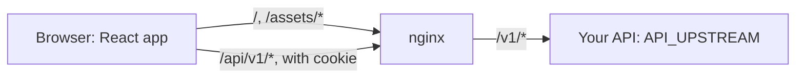
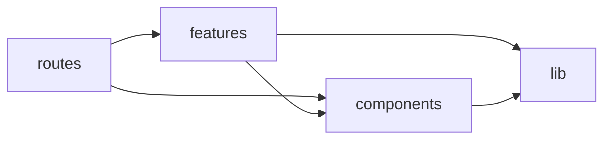

# Architecture

The app is static files plus a proxy. The browser loads the built React app from nginx and calls the API on the same origin under `/api/`. nginx, or Vite in development, forwards those calls to `API_UPSTREAM`. The browser holds the session cookie, so the app's code never sees a token.

## How a page loads

1. **Root.** `src/routes/__root.tsx` runs `GET /v1/users/me` once through `sessionQueryOptions`, which caches the user or `null`.
2. **Guard.** Routes under `src/routes/_authenticated/` redirect to `/login?redirect=<path>` when the user is `null`. The login page accepts only internal paths in `redirect`.
3. **Loader.** The route's loader calls `ensureQueryData`, so data starts loading in parallel with the route's code chunk. Hovering a link preloads both.
4. **Render.** Components read the same query with `useSuspenseQuery`. TanStack Query keeps results fresh for 30 seconds, and the session for 5 minutes.
5. **Focus.** After each navigation, focus moves to the page's `h1`, and the page sets `document.title`.

A 401 from any call, other than a wrong password, marks the user logged out and sends them to log in, then back to where they were. `createQueryClient` in `src/lib/query-client.ts` does this for every query and mutation.

## Modules

| Path | Does |
|---|---|
| `src/main.tsx` | Starts the mock API in mock mode, then renders the app |
| `src/app.tsx` | Creates the query client and router, and wires session loss to the login redirect |
| `src/router.tsx` | Router settings: preloading, default pending, error, and not found views |
| `src/routes/` | File routes. `routeTree.gen.ts` is generated from them |
| `src/features/auth/` | Session query, login, logout, sign-up, and the redirect check |
| `src/features/notes/` | Notes queries and mutations, the list, and the create and edit forms |
| `src/lib/api/` | Generated `schema.d.ts`, the `openapi-fetch` client, `request()`, and `ApiError` with user messages |
| `src/lib/` | Query client, idempotency keys, form error mapping, and error reporting |
| `src/components/` | Page heading, form fields, route states, and `ui/` primitives |
| `src/mocks/` | MSW handlers that implement the contract in memory |
| `docker/nginx/` | Server config, security headers, and the startup check for `API_UPSTREAM` |

## Dependencies

Imports point one way. `test/architecture.test.ts` fails on any other import.

- A feature imports another feature only through its `index.ts`.
- Only a feature's `api.ts` imports the API client. Components call hooks, never the API.
- `components/` and `lib/` never import features or routes.
- Only `src/main.tsx` imports `src/mocks/`, behind the mock mode check, so the build drops it.
- Every component that uses react-hook-form starts with `'use no memo'`, because the React Compiler would memoize its `register()` calls. [Decision 006](decisions/006-keep-forms-out-of-the-react-compiler.md) explains why.

## Tests

| Layer | Runs | Against |
|---|---|---|
| Unit and component | `pnpm test`, in Chromium through Vitest browser mode | The in-memory API in `src/mocks/` |
| Architecture | `pnpm test` | The source files' imports |
| End to end | `pnpm test:e2e`, with Playwright | The built image and a real example API in Docker |
| Lighthouse | `pnpm test:e2e` | The signed-in pages of the built image |
